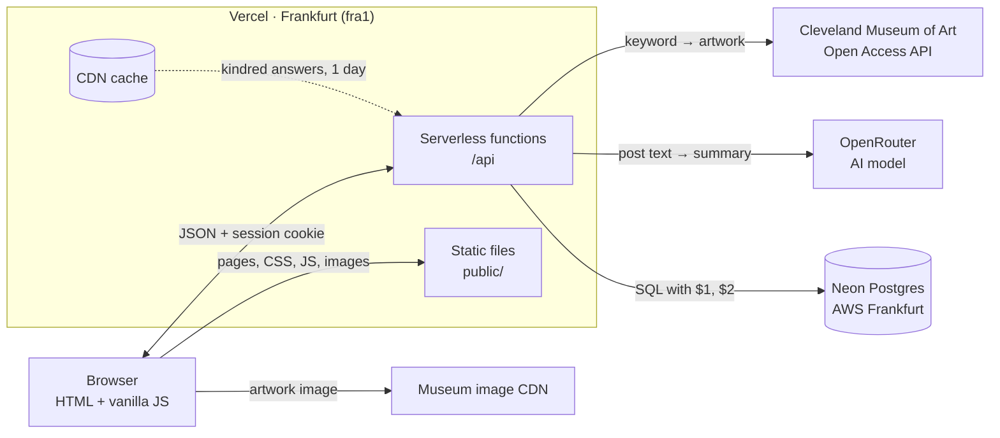
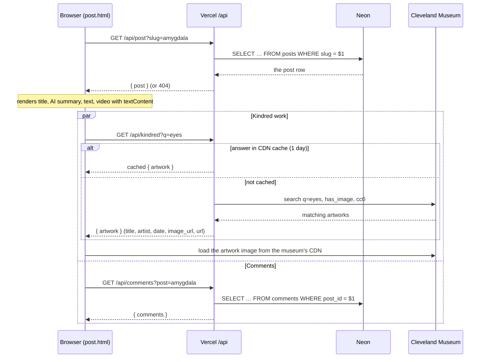
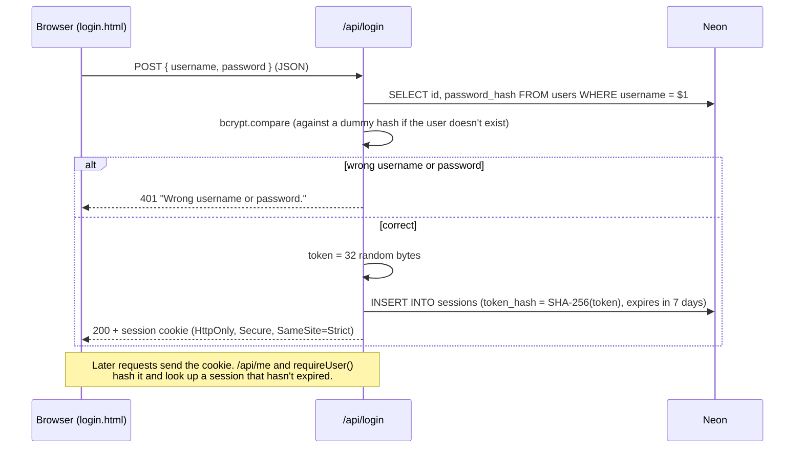
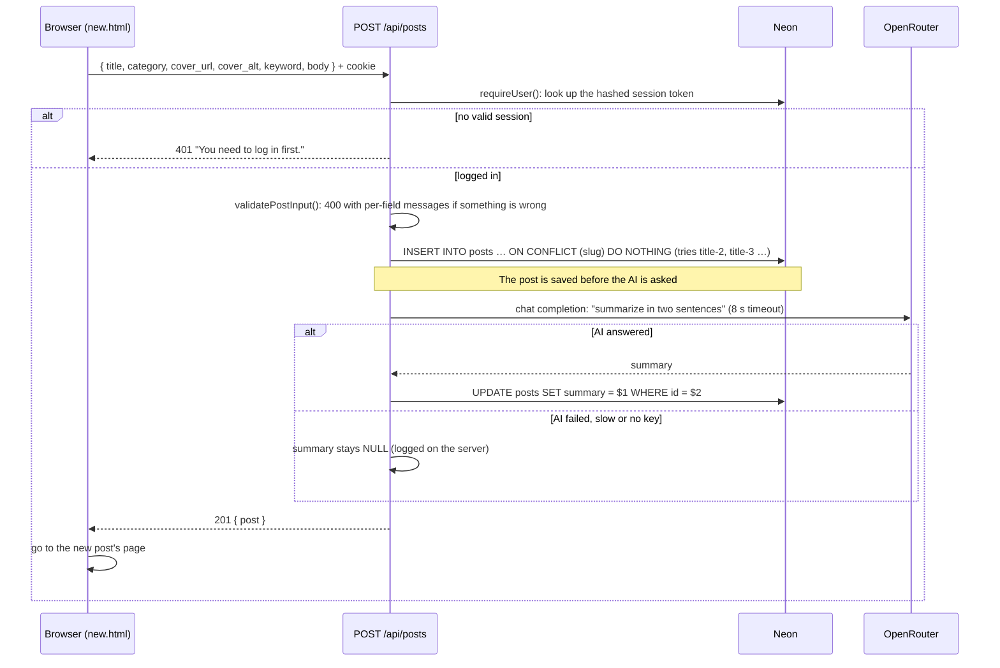
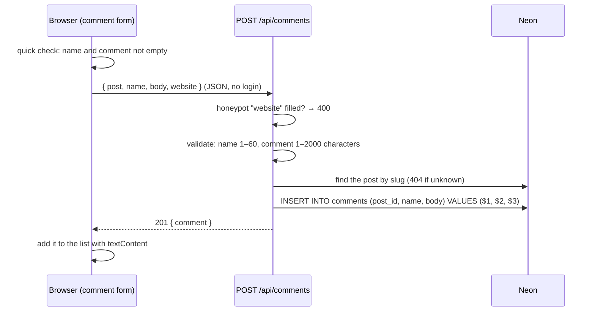

# Architecture

How data flows between the visitor's browser, the Vercel functions, the Neon database, OpenRouter and the Cleveland Museum of Art.

## The big picture

```
                    ┌──────────────────────────── Vercel (Frankfurt) ───────────────────────────┐
┌───────────┐ pages │  public/  HTML, CSS, JS, images                                           │
│           │──────▶│                                                                           │
│  Browser  │       │  /api functions ──── SQL ($1, $2) over HTTPS ───▶  Neon Postgres          │
│           │ JSON  │   posts, post,                                      (AWS Frankfurt)       │
│ HTML + JS │◀─────▶│   comments,     ──── post text ─────────────────▶  OpenRouter → AI model  │
│  modules  │cookie │   login, logout,                                                          │
│           │       │   me, kindred   ──── keyword ───────────────────▶  Cleveland Museum of Art│
└───────────┘       │        ▲                                            Open Access API       │
      │             │   CDN cache (kindred answers kept 1 day)                                  │
      │             └───────────────────────────────────────────────────────────────────────────┘
      └──── artwork image ──▶ Cleveland Museum of Art image CDN
```



**Who knows what**

| Part | Holds | Never sees |
|---|---|---|
| Browser | the pages and an `HttpOnly` session cookie that its JavaScript can't read | database address, API keys |
| Vercel functions | `DATABASE_URL`, `OPENROUTER_API_KEY`, `OPENROUTER_MODEL` (environment variables) | the admin password |
| Neon | users (bcrypt hashes), sessions (SHA-256 hashes of tokens), posts, comments | plain passwords or plain session tokens |
| My computer | `.env` with everything, including `ADMIN_USERNAME` / `ADMIN_PASSWORD` for the seed script | – |

## Reading a post



## Logging in



## Publishing a post with an AI summary



## Adding a comment



## Searching and filtering

This happens entirely in the browser. The home page loads all posts once (`GET /api/posts`). After that, `home.js` filters the array on every keystroke or button press, with no new requests:

```
state = { posts, query, category }
        │
        ▼
posts.filter(post => matchesCategory(post, category) && matchesQuery(post, query))
        │
        ▼
render(): story list, "3 of 8 stories", button counts, URL ?q=…&category=…
```
